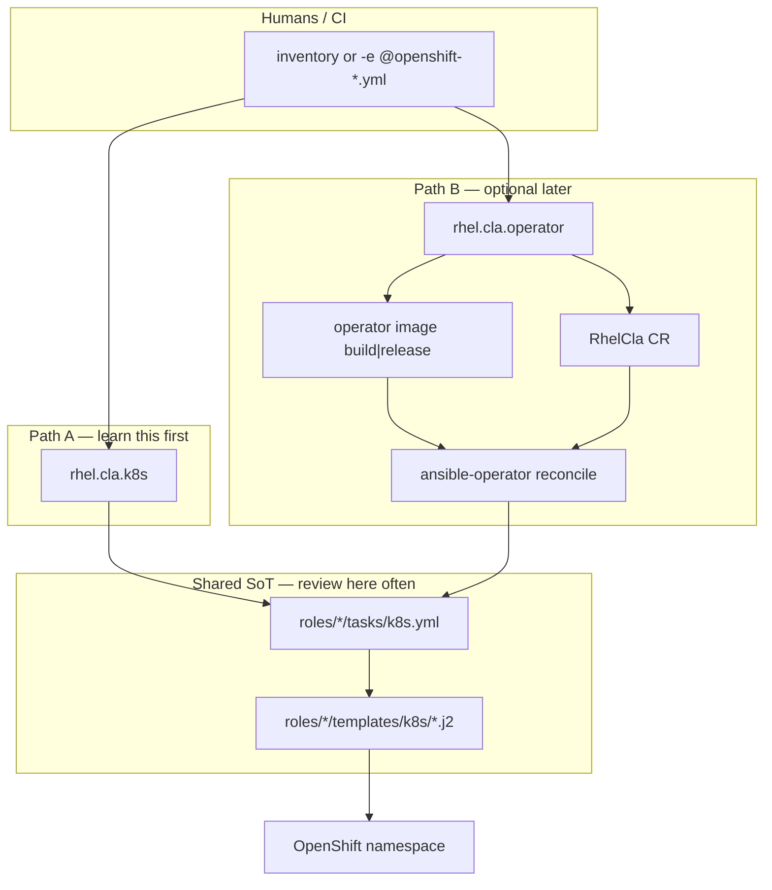

# Design: OpenShift CLA via k8s SoT (+ optional operator)

**Status:** draft — **needs team buy-in before implementation merges**  
**Epic:** [#78](https://github.com/rhel-lightspeed/rhel-cla-installer/pull/78) (docs-only, stays draft)  
**ELI5 companion:** [eli5-ansible-operators.md](eli5-ansible-operators.md)  
**Lab notes:** [../openshift-deployment/OC-Deployment.md](../openshift-deployment/OC-Deployment.md)

## What to do *right now*

1. **Read and comment on this design** (and skim the ELI5 if operators are new).  
2. Agree goals, Path A vs B, SoT invariant, and the wave breakdown in §3.  
3. **Do not** treat coarse preview PRs #79–#82 as the review queue — they only
   sketch four impact areas. After buy-in we open **role-sized** PRs that link
   back here.

Implementation without design agreement is explicitly paused.

---

## 1. Goals / non-goals

### Goals

- One **source of truth** for OpenShift workload objects: role
  `templates/k8s/*.j2` applied with `kubernetes.core.k8s`.
- Same **installer UX** as local: inventory or `-e @file`.
- Optional **operator** path that reuses that SoT (no second manifest tree).
- Humans on the team can **review and eventually own** the design without
  operator expertise on day one.

### Non-goals (this phase / pre–Nov 10 focus)

- Supporting OpenShift templates in `openshift/` as a product path.
- Full OLM marketplace packaging (keep a clean `release` image hook for later).
- Replacing local / multi-host install.
- Perfect e2e OpenShift CI before the team has shared vocabulary (see §5).

---

## 2. Architecture (group-think picture)

**Invariant:** Path A and Path B must apply the **same** templates for the same
vars. If they diverge, Path B is wrong.

---

## 3. Layered delivery (more granular than “one operator PR”)

Suggested merge order after design buy-in. Each PR: **one concern**, links to
this doc §, and (where possible) a tiny check that **local install still works**.

| Wave | Example PR focus | What reviewers learn | Depends on |
| --- | --- | --- | --- |
| 0 | This design + ELI5 (epic #78 docs) | Vocabulary + target picture | — |
| 1a | `cla_k8s` only (ns, NetPol, quota) | Shared cluster scaffolding | 0 |
| 1b | `okp` k8s templates (PVC, Recreate, probes) | One workload role | 1a |
| 1c | `rhel_knowledge_bridge` k8s | Second workload role | 1b |
| 1d | `lightspeed_stack` k8s (auth, Route, probes) | Hardest role; iterate here | 1c |
| 1e | optional `postgresql` k8s | Vertex-shaped deps | 1d |
| 1f | `rhel.cla.k8s` playbook + examples only | Glue for Path A | 1a–1e |
| 2 | Move/add `operator/` scaffold only | Where the binary lives | 0 |
| 3 | CRD + sample `RhelCla` (no reconcile yet) | API shape | 2 |
| 4 | `watches.yaml` + empty/no-op `rhelcla` | Watch → role wiring | 3 |
| 5 | `rhelcla` calls same k8s chain | Reconcile = Path A | 1f + 4 |
| 6 | `rhel.cla.operator` one-shot build\|release | Packaging UX | 5 |

**Preview only:** Draft PRs #79–#82 sketch four coarse areas (k8s SoT → operator
scaffold → CR/reconcile → one-shot). They are **paused / not for merge**. After
this design is accepted, replace them with wave-1+ PRs (or reopen thinner
slices from that work). Nothing is thrown away — it becomes the backlog shape.

---

## 4. Auth / config decisions worth locking early

Call these out in `lightspeed_stack` PRs (wave 1d):

| Topic | Direction | Why |
| --- | --- | --- |
| Default OpenShift auth example | `api-key-token` | Goose-first lab; Bearer clients |
| Config key material | `${env.API_KEY}` (LCORE env expansion) | Secret stays in env; not literal `${API_KEY}` |
| Probes with auth | exec + Bearer (httpGet skips do not match `root_path`) | Avoid crashloops |
| Soft uninstall | Do not delete namespace | Keep pull/OKP secrets |
| `openshift/*.yml` Templates | Reference only | Avoid dual SoT |

---

## 5. Testing strategy (honest, phased)

### What exists today

| Area | Where | Notes |
| --- | --- | --- |
| **Functional installer tests** | External plan repo imported by [`konflux_ci.fmf`](../konflux_ci.fmf): `rhel-cla-installer-tests` on GitLab CEE (`/plans`) | This is the real regression surface for **local / multi-host**. Contact **@mmoran** for how PRs attach / what gates. |
| **Konflux / Tekton** | [`.tekton/`](../.tekton/) | Image **build** pipelines for the installer zipapp/image — not OpenShift e2e. |
| **Testing Farm secrets config** | [`.testing-farm.yaml`](../.testing-farm.yaml) | Env wiring for TF; not the test definitions. |
| **Operator / OpenShift e2e** | Mostly **absent** (lab TESTPLAN only) | Team explicitly OK if OCP path is unfinished this month. |
| **Molecule stubs** | `operator/molecule/…` (when present) | Placeholder; not a gate yet. |

### What “don’t break local” means for OpenShift PRs

1. **Baseline:** existing Testing Farm / `rhel-cla-installer-tests` plans that
   cover `rhel.cla.local` (and multi-host) stay green.  
2. **OpenShift PRs** should avoid changing local Quadlet paths unless
   intentional and covered. Prefer additive `tasks/k8s.yml` + `templates/k8s/`.  
3. **Per-PR confidence** before OCP e2e exists:
   - `ansible-playbook … --syntax-check` on touched playbooks  
   - render/check mode where cheap (`--check --diff` against a dry cluster)  
   - document manual Case A steps in TESTPLAN for roles that need a cluster  

### Later (post vocabulary)

- Expand `rhel-cla-installer-tests` with a plan that only asserts “k8s templates
  render” or “CRD applies”.  
- Optional: molecule for `rhelcla` reconcile against kind/CRC.  
- Operator image smoke in Konflux once Path B is intentional product.

---

## 6. Documentation set

| Doc | Role |
| --- | --- |
| This file | Design + waves + testing map (comment here) |
| [eli5-ansible-operators.md](eli5-ansible-operators.md) | Teaching vocabulary |
| [../openshift-deployment/OC-Deployment.md](../openshift-deployment/OC-Deployment.md) | How to run Path A in a lab |
| [../openshift-deployment/TESTPLAN.md](../openshift-deployment/TESTPLAN.md) | Manual e2e checklist when we choose to run it |

---

## 7. Decision log (edit as we agree)

| Date | Decision | Owner |
| --- | --- | --- |
| 2026-11-04 | Epic #78 stays **draft** docs/overview; **design buy-in first** | Team |
| 2026-11-04 | SoT = role `templates/k8s`; `openshift/` Templates = reference | Draft |
| 2026-11-04 | Coarse stack #79–#82 → **draft / paused** (preview of 4 areas only) | Team |
| TBD | After design ACK: wave-1 role PRs (replace #79–#82) | TBD |
| TBD | Eng tech sync: 30‑min operator show-and-tell | TBD |

---

## 8. Ask of reviewers on this doc

Please comment on:

1. Wave granularity (is 1a–1f too small / still too big?).  
2. Whether Path A must ship before any `operator/` file lands.  
3. Minimum “don’t break local” check you want on every PR before @mmoran’s
   harness grows.
