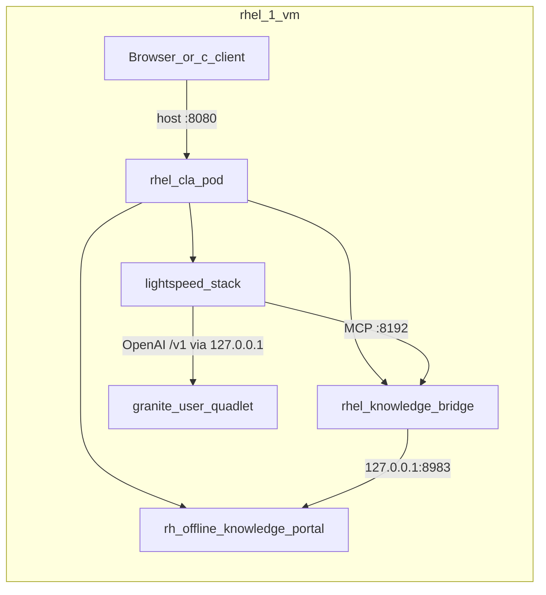
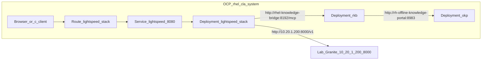

# RHEL CLA on OpenShift — deployment plan and manifests

This directory is a **manifest-first** OpenShift port of the live Podman/Quadlet
CLA stack running on the lab RHEL host (`10.20.1.200`). It intentionally leaves
the existing Quadlet installer path alone.

Branch: `dasm-ocp-deployment`  
Cluster: `2026-prod-1` (`api.2026-prod-1.ocp.dasmlab.org`)  
Namespace: `rhel-cla-system`

---

## Build plan and choices

| Choice | Decision | Why |
| --- | --- | --- |
| Scope | Deploy **OKP + RHEL Knowledge Bridge + Lightspeed Stack** only | Matches the `rhel-cla` Podman pod on the lab host; Granite stays out of cluster for this MVP |
| Granite / LLM | **Option B** — call lab Granite at `http://10.20.1.200:8000/v1` | Same inventory/`ramalama_config` semantics as today; RHOAI cutover later by changing `base_url` |
| Images / tags | Exact tags from the live Quadlet `.image` units | Bit-for-bit parity with what already works on `rhel-1-vm` |
| Config source | `/var/lib/containers/lightspeed-stack/*` + `inventory/hosts.yml` on the RHEL host | Avoid inventing new provider wiring; port what Ansible already rendered |
| Secrets | Created at apply time from host `auth.json` + `okp_access_key` | Never commit OKP key or registry credentials |
| Packaging | Static YAML + Kustomize (primary); Ansible `roles/*/templates/k8s/*.j2` kept in sync for Quadlet/k8s dual path | Reviewable manifests; j2 must match (OKP: Recreate, tar-wrapper, long probes) |
| Network note | Lab Granite must be reachable at `10.20.1.200:8000` from cluster nodes | Live host already publishes `0.0.0.0:8000`; ensure firewalld allows it if pods cannot connect |
| Ports | Lightspeed Service `:8080` → container `:8081`; OKP Solr `:8983`; RKB MCP `:8192` | Mirrors Quadlet `PublishPort=8080:8081` and in-pod localhost URLs rewritten to Services |

### What we are **not** doing in this pass

- Not modifying `docs/setup-granite-quadlet.sh` or the Local Installation README work on PR #61.
- Not installing RHOAI / in-cluster model serving yet.
- Not committing secrets or copying `/etc/containers/auth.json` into git.

### Follow-up (RHOAI)

When RHOAI exposes an OpenAI-compatible endpoint in-cluster:

1. Update [`base/config/llama-stack.yml`](base/config/llama-stack.yml) `providers.inference[0].config.base_url`.
2. Align `models[].provider_model_id` / `default_model` with the served model id.
3. Drop the lab Granite dependency and the `expose-lab-granite.sh` step.

---

## Before / after layout

### Before — Podman Quadlets on RHEL (`10.20.1.200`)



Live units (reference):

- System Quadlets under `/etc/containers/systemd/`: `rhel-cla.pod`, `rh-offline-knowledge-portal.*`, `rhel-knowledge-bridge.*`, `lightspeed-stack.*`
- User Quadlet `~/.config/containers/systemd/granite.container` (LLM only)
- Config: `/var/lib/containers/lightspeed-stack/{lightspeed-stack.yml,llama-stack.yml,system_prompt.txt}`
- Inventory: `/home/dasm/rhel-cla-installer/inventory/hosts.yml` (`rhel_cla_provider: ramalama`, OKP key, model id)

### After — OpenShift (`rhel-cla-system`)



---

## Images (pinned to lab host digests)

Digests taken from `podman image inspect` on `10.20.1.200` for the running Quadlet tags:

| Component | Tag (reference) | Digest-pinned image |
| --- | --- | --- |
| OKP | `…/rhokp-rhel9:1.2.9-1784730494` | `…/rhokp-rhel9@sha256:7f4764ba3c76f1f4b062cbc7847e1eb5a06064c172030f2c9ff3e729ac637b8c` |
| Knowledge bridge | `…/rhel-knowledge-bridge-rhel10:v1.0.2-1785450151` | `…/rhel-knowledge-bridge-rhel10@sha256:2eb8f92f7f093a419e8f01bcb42e7d61729d0177c54f95dd162bd8bc56f36e48` |
| Lightspeed stack | `…/lightspeed-stack-rhel9:0.6.4` | `…/lightspeed-stack-rhel9@sha256:4094c9b5601983497b2dac5f0e6b3e1cb8e6094eaab30f05d0a7a535a49c179c` |

Also applied for lab hardening:

- **NetworkPolicy** — default deny; allow DNS, same-namespace, router→Lightspeed, Lightspeed→Granite `:8000`, kubelet probes
- **ResourceQuota / LimitRange** — namespace caps and container defaults
- **Job `granite-connectivity`** — in-cluster curl to `http://10.20.1.200:8000/v1/models`

---

## Directory layout

```text
openshift-deployment/
  OC-Deployment.md                 # this file — plan, choices, diagrams
  Makefile                         # build / seed / apply / verify / status
  examples/
    command-line-assistant.config.toml.example
  base/                            # Namespace, Deployments, Services, Route, SAs, PVC
    okp-deployment.yaml            # Recreate + long startupProbe + tar-wrapper mount
    okp-tar-wrapper-cm.yaml        # Shadows tar for Solr index unpack under restricted SCC
    okp-pvc.yaml                   # 40Gi RWO lvms-vg1 for Solr data
    config/                        # Lightspeed config ported from the RHEL host
      lightspeed-stack.yml
      llama-stack.yml              # base_url -> http://10.20.1.200:8000/v1
      system_prompt.txt
  overlays/lab/                    # Lab overlay (kustomize entrypoint)
  scripts/
    seed-secrets-from-rhel.sh      # pull-secret + okp-access-key from RHEL host
    expose-lab-granite.sh          # optional: PublishPort 0.0.0.0:8000
    apply.sh                       # oc apply -k + wait
    verify.sh                      # pods / route / Granite checks
```

---

## Apply (lab)

Prereqs: `oc` logged into `2026-prod-1` as a user that can create projects/secrets/deployments/routes.

```bash
# 0) Lab Granite must already listen on 0.0.0.0:8000 (current rhel-1-vm state).
#    Only if it is bound to 127.0.0.1 again:
#    RHEL_PASS=... ./openshift-deployment/scripts/expose-lab-granite.sh

# 1) Seed secrets from the RHEL host inventory + auth.json
RHEL_PASS=... ./openshift-deployment/scripts/seed-secrets-from-rhel.sh

# 2) Apply manifests (OKP image pull can take 10–30+ minutes)
./openshift-deployment/scripts/apply.sh
```

Verify:

```bash
oc -n rhel-cla-system get pods,svc,route
HOST=$(oc -n rhel-cla-system get route lightspeed-stack -o jsonpath='{.spec.host}')
curl -sk "https://${HOST}/api/lightspeed/liveness"
```

Point `command-line-assistant` `endpoint` at `https://<route>/v1` (or http if testing insecure) the same way the README describes for local `:8080`.

---

## Client tip

See [`examples/command-line-assistant.config.toml.example`](examples/command-line-assistant.config.toml.example).
Point `endpoint` at the **Route** `/v1`, not at Granite `:8000`.

```bash
make -C openshift-deployment status
make -C openshift-deployment verify
```

## OKP on OpenShift (must ship with the manifests)

RHOKP’s first start unpacks a large Solr/Lucene index. On OpenShift that interacts
badly with default probes, RollingUpdate, and restricted SCC unless the delivered
manifests encode the following (already in `base/` and mirrored in
`roles/okp/templates/k8s/`):

| Requirement | Manifest behavior | Why |
| --- | --- | --- |
| Single pod / RWO | `strategy: Recreate` (not RollingUpdate `maxSurge: 1`) | Second surged pod cannot attach the RWO PVC; both crashloop |
| Long first boot | `startupProbe` ~45m window; softer liveness/readiness; `progressDeadlineSeconds: 3600` | Index pull/extract takes far longer than default probe budgets |
| Restricted SCC unpack | ConfigMap `rh-offline-knowledge-portal-tar-wrapper` mounted at `/usr/local/bin/tar` + `PATH=/usr/local/bin:/usr/sbin:/sbin:/usr/bin:/bin` | Stock `tar` fails with `Cannot change mode` / `Cannot utime` (setgid) → **`ERR_013`**. Do **not** set a PATH that omits `/usr/sbin` or `run-httpd` fails with `exec: httpd: not found`. Not a corrupt image. |
| Durable index | PVC `rh-offline-knowledge-portal-data` (40Gi RWO) | Survives pod restarts; wipe only when re-seeding a failed partial extract |

When changing the wrapper script, bump the pod template annotation
`configmap-hash` (e.g. `tar-wrapper-v5`) so the Deployment rolls.

Ansible/Quadlet path: keep
`collections/ansible_collections/rhel/cla/roles/okp/templates/k8s/okp-deployment.j2`
and `okp-configmap.j2` aligned with the static YAML above.

## Troubleshooting / known issues

| Symptom | Likely cause | What to do |
| --- | --- | --- |
| Pods stuck `ContainerCreating` / `Pulling` for a long time | OKP image is multi‑GB; registry pull is slow | Wait; `oc -n rhel-cla-system describe pod …` — `ErrImagePull` means auth/network, plain `Pulling` means still downloading |
| `ErrImagePull` / `ImagePullBackOff` | Missing/invalid `redhat-pull-secret` | Re-run `RHEL_PASS=… ./scripts/seed-secrets-from-rhel.sh` |
| OKP logs `ERR_013` / `tar: Cannot change mode` / `Cannot utime` | Missing tar-wrapper under restricted SCC | Ensure `okp-tar-wrapper-cm.yaml` is applied and mounted; bump `configmap-hash`; wipe PVC only if a partial bad extract remains, then let OKP re-unpack from the image |
| OKP httpd `AH00111` / `AH01506` / `AH01909` for `MIMIR_*`, `ONLINE_VIEW`, `UNCLASSIFIED_BANNER`, `ASK_RED_HAT_OFFLINE` | Optional/internal env vars unset; httpd `PassEnv` warns | **Same on the Quadlet reference** (`dasm@10.20.1.200`). RH docs only document optional `ACCESS_KEY`, `ONLINE_VIEW`, `SOLR_MEM`, `UNCLASSIFIED_BANNER` ([Customize RHOKP](https://docs.redhat.com/en/documentation/red_hat_offline_knowledge_portal/1/html/install/install-customize_your_red_hat_offline_knowledge_portal_deployment)). `MIMIR_HTTPD_SERVER_NAME`, `MIMIR_MISSING_ACCESS_KEY`, `ASK_RED_HAT_OFFLINE` are **not** documented — do not invent values. Safe to ignore; set `ONLINE_VIEW` / `UNCLASSIFIED_BANNER` only if you want those UI features |
| Two OKP pods, both not Ready / volume attach errors | RollingUpdate + RWO PVC | Delivered strategy must be **Recreate**; scale/roll so only one ReplicaSet has pods |
| OKP CrashLoop during first extract (no ERR_013) | Probes too aggressive | Use the long `startupProbe` / soft liveness from `okp-deployment.yaml`; do not shrink those for “faster” CI |
| Lightspeed Ready but chat fails | Cluster cannot reach `10.20.1.200:8000` | Confirm Granite listens on `0.0.0.0:8000`; open firewalld; test with `verify.sh` / an in-cluster `curl` pod |
| OKP restarts lose knowledge index | Using emptyDir | Lab uses **40Gi PVC** (`rh-offline-knowledge-portal-data`) |
| Route TLS / client errors | Edge termination + self-signed / corporate CA | Test with `curl -sk https://<route>/api/lightspeed/liveness` first |
| Nested SSH seed script hangs | Fragile remote python over password SSH | Prefer current `seed-secrets-from-rhel.sh` (captures to files); or create secrets manually |

## Teardown

```bash
make -C openshift-deployment teardown
# or: oc delete project rhel-cla-system
```
